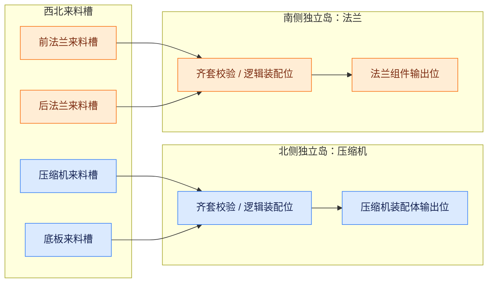

# Neo4j 图谱驱动的混线装配 MVP 实施方案

## 1. 目标

在现有柔性车间基础上，先搭出可观察的两座独立产品岛，再打通“订单输入 → 本岛物料槽 → 工序依赖 → 逻辑装配 → 成品追溯”的完整闭环。首版用简化逻辑合流替代机器人轨迹，不要求真实抓取、插装或螺纹运动。

验收重点是业务逻辑和场景闭环：同一场景可分别接收两种产品订单，按各自结构完成简化合流，并能从运行结果还原组件父子关系。MVP 先验证产品切换和谱系正确，不验证多订单同时运行、工位争抢或真实机器人装配能力。

## 2. 图谱范围与业务映射

导出有 222 个节点、384 条关系，含产品/组件、工艺分类、操作、目标、动作和能力。MVP 只抽取以下与演示直接相关的子图，保留原始 Neo4j 节点 ID 作为来源追溯信息：

| 产品流 | 图谱事实 | MVP 中的解释 |
|---|---|---|
| 压缩机组件 | `冰箱压缩机装配体` `include` `冰箱压缩机`、`冰箱压缩机底板`；零件能力涉及孔/轴；两组件关联“实现轴孔装配”目标 | 两种来料在压缩机独立岛的指定输入槽齐套后，执行一项简化的轴孔装配逻辑，生成压缩机装配体 |
| 前后法兰组件 | `前后连接法兰组件` `include` 前、后连接法兰；组件及零件关联装配目标/特征 | 前、后法兰在法兰独立岛的指定输入槽齐套后，执行一项简化的组件装配逻辑，生成法兰组件 |
| 工艺步骤 | 轴孔装配目标关联抓取基准件、提起/翻转、抓取配合件、对齐、装配、释放等操作，且存在 `after` 顺序关系 | 首版保留业务步骤顺序作为工序说明/事件阶段；执行器可把整段折叠为一个虚拟工位工序 |

图谱中的 `include` 用于产品结构；`achieve_goal` 用于产品与目标工艺的关联；`operation`/`after` 用于目标工艺的步骤和先后；`has_capability`、`has_action` 用于解释所需能力及动作。文本型的设备、环境、异常和注意事项字段不是经过验证的仿真约束，不进入首版派工或运动逻辑。

## 3. MVP 场景与工艺

### 3.1 场景范围

从当前 L5_UFLOW 五岛布局和既有场景构建/工件生命周期机制派生一份新的、可版本化的 MVP 场景工件；不覆盖受保护的 v1 基线工件。场景以现有输送线、A–E 工位、共享 AGV 和区域为底图，增加或明确标出：

- 两种产品的来料/组件对象和来源区；首版使用简单几何体或现有形状，不制作精细 CAD。
- 组件等待位、装配工位、输出位及可读的对象 alias。
- 两组组件到各自逻辑合流节点的供料关系；通过地面线/标签表现逻辑流向，不制作或声称存在实际输送机构。
- 组件与成品的颜色/标签区分，以及运行时对象到物料 UID 的稳定绑定。

新增场景对象以业务可辨认、alias 稳定、位置可绑定为准，不新增机器人模型、专用工具、传感器或复杂输送机构。场景布局若不能在现有 contract/alias 机制中表达，先扩展最小必需绑定，不先重写 scene builder。

### 3.2 两条产品工艺

首版固定两种配方，各由两种来料组成，分别合流生成一个目标成品：

```text
COMPRESSOR + BASEPLATE
  → 两个订单来源槽直接生成 → VIRTUAL_SHAFT_HOLE_ASSEMBLY → COMPRESSOR_ASSY

FRONT_FLANGE + REAR_FLANGE
  → 两个订单来源槽直接生成 → VIRTUAL_FLANGE_ASSEMBLY → FLANGE_ASSY
```

产品/物料代码可采用以上稳定英文 ID；中文显示名来自本地映射表。实现前核对现有 `ItemType`、目录、物料颜色及 persistence seed 的影响，只增加本 MVP 所需的有限物料类型，不做开放式物料主数据系统。订单目标类型分别为 `COMPRESSOR_ASSY` 和 `FLANGE_ASSY`。

工序图表达“订单在指定来源槽生成两种组件 → 指定装配节点等待两个绑定端口齐备 → 消费父件并创建成品”。两类配方使用各自明确的 join/输出类型；不得把任意两件到站物料默认配对。两种产品各用一份现有 `OrderSpec`，分别完成 validate、compile、run；演示按“压缩机一单 → 法兰一单 → 再压缩机一单”的固定序列重复投产，体现同场景可切换产品。现有订单契约一次只指定一种目标物料类型，coordinator 一次只加载一个 `CompiledOrder`，所以 MVP 不把两个目标伪装成一张订单，也不声称实现同时派工。多订单并发和资源争抢属于后续扩展。

### 3.3 场景俯视草图与对象

场景沿用 L5_UFLOW 的五岛车间作为底图，在西侧预留区增加两个**独立、无机械臂的装配岛**：北侧压缩机岛、南侧法兰岛。每个岛自带两种物料槽、齐套/逻辑装配位和成品位，岛内物料只走本岛流程；订单切换决定当前运行哪座岛，防止把两条产品路线画成任意混配。坐标以现有场景 XY 世界坐标（米）为准；L5_UFLOW 地板边界为 `x=[-4,4]`、`y=[-3,3]`。新岛 footprint 是规划初值，需再与现有静态占位、机械臂工作包络及 AGV 道路做静态/实机复核。



俯视位置建议如下。每个独立岛 footprint 约 `2.4 × 1.25 m`。4 个来料槽是订单的初始物料 zone；本 MVP 不另加输送动作，订单开始时组件直接在本岛对应槽位生成。执行装配后父组件从场景中移除，成品在本岛输出位生成。两个岛的日常补料/成品取走按人工交接处理，不延伸或改变当前 AGV 路网。

| 对象/区域 | 建议 alias / zone ID | XY 米 | 显示/用途 |
|---|---|---:|---|
| 压缩机独立岛 footprint | `MVP_Island_COMPRESSOR` | 中心 `(-2.55, 2.12)`，约 `2.4 × 1.25` | 北侧独立单元；静态轮廓/局部工作台 |
| 压缩机来料槽 | `MVP_Source_COMPRESSOR` / `mvp_source_compressor` | `(-3.50, 2.38)` | 蓝色来料，容量 1 |
| 底板来料槽 | `MVP_Source_BASEPLATE` / `mvp_source_baseplate` | `(-3.50, 1.86)` | 青绿色来料，容量 1 |
| 压缩机逻辑装配位 | `MVP_Compressor_Assembly` / `mvp_compressor_assembly` | `(-2.55, 2.12)` | 本岛齐套与逻辑 join 位置，不表现机械臂动作 |
| 压缩机成品位 | `MVP_Output_COMPRESSOR_ASSY` / `mvp_output_compressor_assy` | `(-1.60, 2.12)` | 蓝绿色输出，容量 1 |
| 法兰独立岛 footprint | `MVP_Island_FLANGE` | 中心 `(-2.55, -2.12)`，约 `2.4 × 1.25` | 南侧独立单元；与北侧岛隔离 |
| 前法兰来料槽 | `MVP_Source_FRONT_FLANGE` / `mvp_source_front_flange` | `(-3.50, -1.86)` | 橙色来料，容量 1 |
| 后法兰来料槽 | `MVP_Source_REAR_FLANGE` / `mvp_source_rear_flange` | `(-3.50, -2.38)` | 黄色来料，容量 1 |
| 法兰逻辑装配位 | `MVP_Flange_Assembly` / `mvp_flange_assembly` | `(-2.55, -2.12)` | 本岛齐套与逻辑 join 位置，不表现机械臂动作 |
| 法兰成品位 | `MVP_Output_FLANGE_ASSY` / `mvp_output_flange_assy` | `(-1.60, -2.12)` | 紫色输出，容量 1 |

`MVP_*` 是场景 alias；`mvp_*` 是领域 zone ID，两者不可混用。实际在制品沿用现有 `Part_{uid:04d}` 命名，以 `ItemType` 着色，并通过材料账本 UID 与订单绑定。场景只需岛面、槽位框线/小托盘、逻辑工位牌和成品标记；不制作精细零件、不加机器人、AGV 或新传送带。所有辅助几何体用静态、非响应属性，避免改变现有运动/碰撞基线。

### 3.4 样例订单契约

每个产品使用一份独立的现有 `OrderSpec`：两个 `inputs` 明确写 `node_id` 和 `port_id`，一个装配节点引用对应的白名单模板，target 指向该订单唯一的成品类型。压缩机订单的结构示意：

```json
{
  "order_id": "mvp-compressor-001",
  "version": 1,
  "scene_id": "L5_UFLOW",
  "target": {"item_type": "COMPRESSOR_ASSY", "quantity": 1},
  "inputs": [
    {"input_id": "compressor", "item_type": "COMPRESSOR", "quantity": 1,
     "zone": "mvp_source_compressor", "node_id": "assemble", "port_id": "compressor-in"},
    {"input_id": "baseplate", "item_type": "BASEPLATE", "quantity": 1,
     "zone": "mvp_source_baseplate", "node_id": "assemble", "port_id": "baseplate-in"}
  ],
  "nodes": [{"node_id": "assemble", "template_id": "mvp_compressor_assembly"}],
  "edges": []
}
```

法兰订单使用 `FRONT_FLANGE`、`REAR_FLANGE`、`FLANGE_ASSY` 和 `mvp_flange_assembly`，并分别绑定 `front-in`/`rear-in` 端口。编译器分配父 UID 和输出 UID；运行时只能按该实例的两个输入 UID 装配，不能按“先到先配”跨订单消费。法兰订单单独以 `FLANGE_ASSY` 为 target。一个订单里不能并排放两个不同成品节点：当前 validator 会要求全部 DAG 节点都通向同一目标物料类型，target/acceptance 也只有一个类型。

## 4. 最小代码改动边界

复用现有 `OrderSpec`、目录校验、`OrderDagCompiler`、`OperationRuntime`、`Stage4Coordinator`、`ResourceTable`、`MaterialRegistry`、运行报告和 artifact 生命周期。实现范围原则上限于以下责任点：

| 责任点 | 预期最小改动 |
|---|---|
| 物料类型 | `domain/materials.py` 的封闭 `ItemType` 与 `domain/rules.py` 的类型集合/颜色表增加 6 个有限类型；按订单输入 zone 注册容量与 `_SOURCE_ITEMS_BY_ZONE` 精确生成位置。新类型无需改写既有类型转换映射 |
| 工艺目录 | `domain/default_process.py` 增加两个逻辑 join operation 模板（各自明确输入类型/zone、输出类型/zone、输入端口 ID）；`domain/process_model.py` 登记一个固定 `mvp_pair_assembly` handler ID。沿用当前订单目录校验，不新增通用 recipe 图编译器或 DB 模式 |
| 订单 join | `application/coordinator.py` 的 `_execute_order_join()` 当前把 `SEMI_CE + PART_DE` 写死；改订单模式为按 `template.inputs` 的端口类型/zone 和编译后的 `instance.input_uids` 校验，再把类型/zone/输出类型传给 `MaterialRegistry` 的订单提交入口。保留 legacy `e_material_pair` 原调用契约和 `commit_join()` 行为 |
| 谱系提交 | `domain/materials.py` 的 `commit_join_uids()` 当前固定校验 `SEMI_CE/PART_DE`、`buffer_e_*` 并生成 `FINAL`。为订单 join 增加最小通用提交参数（两个期望输入端口、输出类型/zone、父 UID），复用消费检查、重复配对拒绝、父子记录和 `JOIN_COMMIT` 事件；legacy E 岛入口继续使用原常量 |
| 场景与位置 | `simulation/scene.py` 的 `Stage4Scene` 构建/采用路径与 `application/lifecycle.py` 的 `build()` 是实际场景接入点；新增窄扩展模块创建展示几何体和返回 zone→pose 映射，并在 lifecycle `build` 增加显式 `assembly_mvp` 选项。当前 `cli.py` 的 build parser 没有 profile 参数，因此增加 `--profile assembly_mvp`；复用已存在的 `--artifact-root` |
| 测试/订单输入 | 新增 `tests/test_v1_assembly_mvp.py` 覆盖两种输入组合、错误端口、重复消费和父 UID 谱系；用现有订单 JSON/schema/API/CLI 各跑一份 fixture。既有报告如已有 genealogy/event 输出则直接断言，不增加新报告格式 |

首版沿用当前 logic join 在 coordinator tick 中即时提交的执行方式，不引入自定义执行器、工位计时状态或新资源锁；两个“逻辑装配位”是各自产品岛中的可视标记和业务映射，两种配方各有独立 join 模板。原子消费、成品登记、谱系和订单完成仍由既有 coordinator/runtime/registry 路径完成。多订单共享资源的互斥必须等到 coordinator 支持一次装载多订单后再实现。

## 5. 工作包与门槛

### WP0：锁定 MVP 子图和验收输入

1. 从 `fmpmm_graph.json` 导出两条产品的节点/关系清单，确认组件成员、目标、操作顺序和源节点 ID。
2. 将各个图谱事实映射到 MVP 领域对象；对缺失或含混的工艺语义采用显式业务假设并标注，不从空字段推导约束。
3. 固定两个产品各一单的输入、组件数量、预期成品和预期父 UID 数；确定最小混合订单序列。

**门槛：**每个工序节点都有输入、输出、前置、完成条件和可见位置；两个产品的组件不能串单配对。若产品结构/输入输出仍有歧义，停在映射澄清，不扩代码。

### WP1：先建场景

1. 使用 `flexible-factory build` 从保留的 `stage3/L2_MIRROR` 父工件构建基础 L5_UFLOW；在 `LifecycleManager.build()` 与 `cli.py` build parser 增加显式 `--profile assembly_mvp`，再调用 `assembly_mvp_scene.py`。不要从默认 current 加载后覆盖保存。
2. 新增对象 alias 和坐标集中放在 `simulation/assembly_mvp_scene.py`，不塞入 `simulation/config.py`/`layout.py`，以免改变现有 `config_digest`/`layout_digest`。该模块提供 `build_extension(sim, scene)`、`bind_extension(sim)`、`verify_extension(sim)` 三个窄函数。
3. 先只创建两块岛面、4 个来料槽、2 个产品专属逻辑装配位、2 个输出位；在 CoppeliaSim 中检查俯视角下不与 A–E、仓库、现有输送线及 AGV 通道相交。固定相机/视角仅在现有 builder 能力允许时调整，首版不为视角另建相机控制层。
4. 用独立 artifact root，例如 `docs/scene_artifacts/experiments/assembly-mvp` 保存工件；新工件保留 parent artifact、source manifest digest 和 profile provenance。
5. save 后沿用 lifecycle 的“保存→重载→校验→写 manifest/validation/lifecycle”流程；MVP 扩展校验单独核对新增 alias 唯一、坐标在地板范围、槽位互不重叠、输出位不与现有运动对象/通道相交。

**门槛：**停止态可加载；新增 alias 按扩展命名规则可唯一解析、必需位置可解析；场景对象使用静态展示属性；扩展 artifact 可用显式 artifact root 加载；默认 v1 current 指针、旧场景工件 digest 和既有 `full_flow` 不变。

### WP2：单产品订单闭环

1. 在 `rules.py`/`ItemType` 加 `COMPRESSOR`、`BASEPLATE`、`COMPRESSOR_ASSY`、`FRONT_FLANGE`、`REAR_FLANGE`、`FLANGE_ASSY`；配置颜色、4 个输入 zone、2 个输出 zone 的容量/业务映射，不改冻结的仿真资源清单。
2. 先只加 `mvp_compressor_assembly` 逻辑模板和一份 fixture。模板端口要和 fixture 的 `node_id`/`port_id` 完全匹配，输出为 `COMPRESSOR_ASSY`；handler 固定登记 `mvp_pair_assembly`。
3. 在 coordinator 的 `_SOURCE_ITEMS_BY_ZONE` 补四个来料落点；`_zone_material_pose()` 补两个输出位置，未知 zone 继续报错，禁止回退到 E 岛输出点。
4. 改订单 join 物料提交路径为模板驱动，先通过压缩机 fixture 验证端口类型、zone、编译父 UID，成功后两个输入各消费一次并生成对应成品；再加入法兰类型/模板/fixture。
5. 对两份 fixture 分别执行 `order validate --file`、`order create --file --source fixture`、`order preview --order-id --version`、`order start --order-id --version --artifact-root <MVP_ROOT> --artifact-id current`；保留 fixture JSON 和每次运行的 run ID 作为复现输入。
6. 成品通过 `scene.spawn_material` 放到指定输出位；两个父组件只在账本 commit 成功后从场景/`MaterialManager`/运行时集合移除。失败时不留半成品谱系。

**门槛：**一单生成一个 `COMPRESSOR_ASSY`，父 UID 恰为压缩机与底板输入 UID，两个输入各消费一次；事件和运行快照可还原输入、join、输出顺序。

### WP3：第二产品及混线闭环

1. 添加 `mvp_flange_assembly`，输入端口为 `front-in`/`rear-in`，输出固定为 `FLANGE_ASSY`；使用同一个固定 `mvp_pair_assembly` 提交处理器，但输入/输出映射从被校验的模板读取。
2. 先单独 validate/compile/run 一单法兰；核对两个父 UID 和输出，不修改压缩机 fixture。
3. 混线演示固定序列运行“压缩机 → 法兰 → 压缩机”（每次使用独立订单/运行 ID），复用同一个派生场景工件，检查切换产品后 source/output zone、颜色和父 UID 映射正确；每次运行分别检查订单状态和报告。
4. 场景复位后再运行下一笔，避免复用上一笔残留的输入/输出对象或假装它们来自当前运行。若现有生命周期没有复位能力，分别从同一基础扩展 artifact 启动每笔订单，不新建批次 orchestration 服务。
5. 记录明确边界：该序列证明两条产品路线可在同一柔性车间场景交替生产，不证明同时在制或工位互斥。多订单并发只有在独立需求确认后，才扩展 `CompiledOrder`/coordinator 的订单集合接口。
6. 保存默认 `full_flow` 回归与 MVP order report；实机场景不可用则只标记纯逻辑通过，不把模拟执行说成场景通过。

**门槛：**两类订单各完成一个目标成品；成品只消费其自身订单的两个组件；订单节点终态与物料账本一致；无重复输出、未消费父件或物料所有权不明。

## 6. 验收

- 新 MVP 场景工件可通过现有加载、绑定和校验流程；受保护的 v1 基线不变。
- 压缩机订单、法兰订单分别可独立验证、编译和完成。
- 两种配方在同一扩展场景中可按固定订单序列交替完成；首版不验并发互斥。
- DAG 的齐套条件准确：缺任一组件不得完成装配；错误类型、跨订单配对和重复消费均被拒绝。
- 每个成品记录正确的两个父 UID；物料事件可追溯来源 zone、订单输入端口、join operation 和输出 zone。
- 简化步骤明确标记为虚拟/逻辑执行，不将其报告为机器人动作或真实装配质量验证。
- 针对变更运行相关领域/订单/coordinator 测试、完整纯逻辑测试；CoppeliaSim 4.10 可用时跑新工件单产品与混线端到端验收，并回归既有 `full_flow`。

## 7. 明确不做

- 不接入 Neo4j 查询服务或在仿真热路径动态读取图谱；本轮把已导出的有限子图审核后映射为代码内静态配方。
- 不做通用图谱到 recipe 的自动编译、任意 DSL、用户可编辑工艺或任意 join 插件。
- 不做真实轴孔插装、螺纹旋合、抓取姿态规划、视觉定位、质量/公差判定或工业节拍校准。
- 不扩展多 AGV、多工厂、通用 MES/ERP 集成、优化求解器、设备故障恢复或动态改道。
- 不重建整厂、不新增 scenario 框架、不改写订单持久化架构、不改受保护的 v1 scene artifact。
- 不将图谱中缺少可靠数值来源的节拍、设备可达性、设备健康、异常概率或环境属性用作仿真事实。

## 8. 外部参考

- CoppeliaSim 场景由环境、模型/对象、主脚本和视图共同构成；本方案因此先派生并校验场景工件，再接入订单运行逻辑：[Scenes and models](https://manual.coppeliarobotics.com/en/scenesAndModels.htm)、[Scenes](https://manual.coppeliarobotics.com/en/scenes.htm)。
- 场景对象可用 shape、dummy 等基础对象表达，位姿相对世界坐标或父级坐标定义；MVP 展示位优先使用静态 shape/dummy，不增加传感器或动力学对象：[Scene objects](https://manual.coppeliarobotics.com/en/objects.htm)。
- CoppeliaRobotics 官方 `scenes` 仓库提供默认场景与 `pickAndPlaceDemo.ttt`，可观察对象层级、视图和演示场景组织；不复用其工厂尺寸或脚本：[官方场景仓库](https://github.com/CoppeliaRobotics/scenes)、[pickAndPlaceDemo.ttt](https://github.com/CoppeliaRobotics/scenes/blob/master/pickAndPlaceDemo.ttt)。
- 岛式生产参考 Hatch 的真实模块化 manufacturing cell 布置：每个 cell 自包含、流程职责清楚，并能按产品切换调整；本方案只借鉴独立 cell 边界、就近物料槽和清晰通道，不照搬其工位/设备尺寸：[Inside Hatchworx Cells](https://www.hatch-pd.com/blog/the-power-of-our-manufacturing-plant-layout-inside-hatchworx-cells)。

本方案 §3.3 Mermaid 图和 XY 表是本项目第一版搭建参考；坐标是待实机场景检查的初值，不是测量结果。官方场景/手册只参考对象类型、层级和场景组织，不直接复用其它工厂的尺寸或运动参数。

## 9. 实施停止条件

任一条件成立时停止向下扩展，并保留已完成的场景/逻辑结果：图谱子图无法确定两个产品的组件对应；新增场景 alias 无法在现有契约中稳定绑定；逻辑 join 无法复用 coordinator 的运行状态与物料提交边界；混线时出现跨订单配对或物料所有权不一致。此时只修复该具体边界，不增加通用抽象或扩大产品范围。
