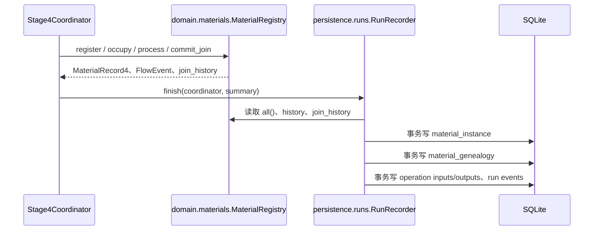
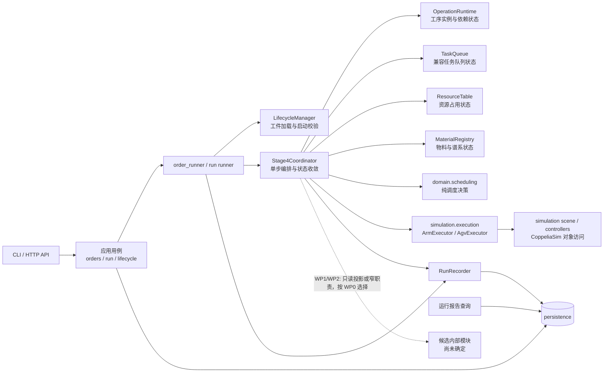
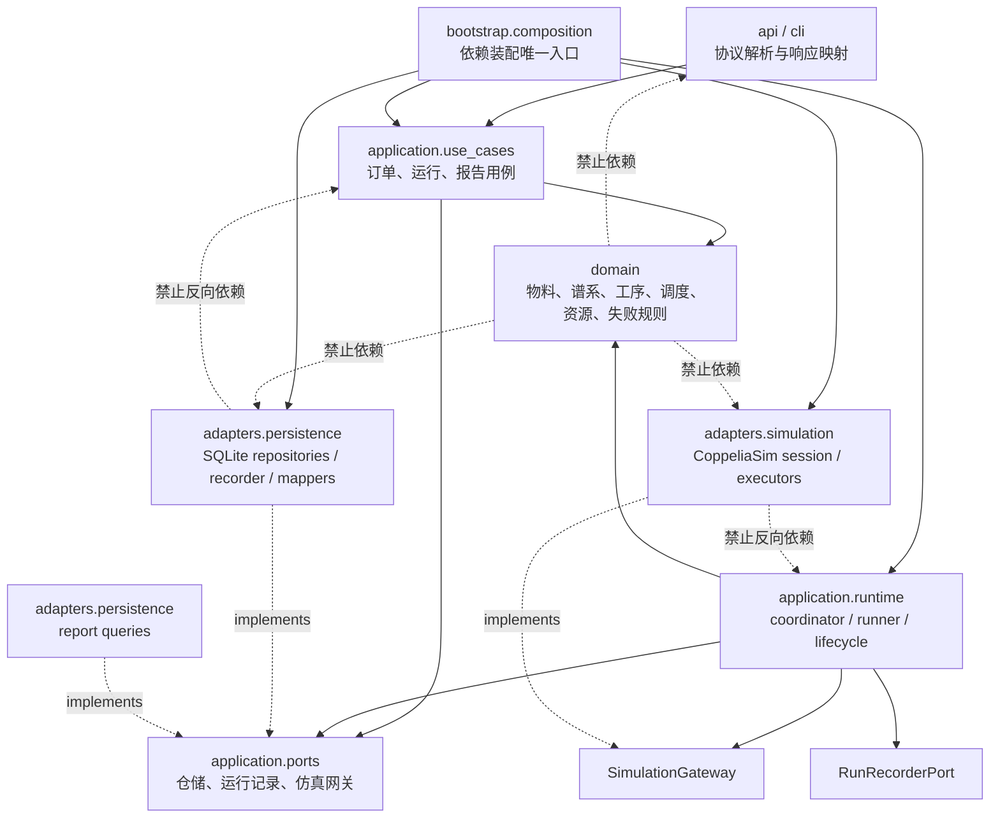
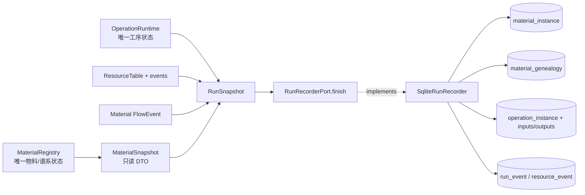

# 应用编排模块边界整理规划

## 目标与判断

当前代码已有 `domain`、`simulation`、`application`、`persistence`、`artifacts`
和 `api` 分层，并通过导入边界测试约束部分依赖方向。当前需要的是局部职责整理，
不是拆成多个发行包、进程或微服务。

本规划以 `application/coordinator.py` 为首要候选：它同时组织来源生成、工序派工、
资源申请、执行器轮询、单步仿真、结果校验与物料提交、故障冻结和验收汇总。文件约
2,845 行是需要检查的信号，不是拆分验收标准。`application/planner.py` 已拆成候选
搜索、校验和后处理等职责，仿真代码优化报告记录了该工作；本规划不重复拆分它。

## 约束

- 维持唯一 CLI、单一仿真 worker 和现有包结构；无新增运行进程、服务、数据库或插件机制。
- 保留 `Stage4Coordinator` 的对外构造和调用方式，除非调用方盘点证明有必要调整。
- `Stage4Coordinator.step()` 继续是唯一仿真步进所有者；执行顺序保持
  `pre_tick → sim.step → post_tick → reconcile`。
- 资源申请、失败范围判定、安全冻结、物料账本提交和事件时序不得因代码移动而改变。
- 不改订单 DAG、配置/布局摘要、场景工件、控制器行为、碰撞判据或公开 CLI/API 契约。
- 新模块须有单一、可描述的责任，并以普通数据或窄接口交互；不为未来可替换性预建
  通用容器、服务定位器或多层 facade。
- 每个工作包独立实施和验证。若某职责无法在不复制运行状态或绕过协调器的情况下拆出，
  保持原位并记录原因。

## 物料和谱系为什么没有直接依赖 persistence

它们实际上已经接入 persistence，但连接点在运行记录边界，而不是
`MaterialRegistry` 内部。当前链路是：



这样设计有五个直接原因：

1. `MaterialRegistry` 是领域状态唯一所有者，负责 UID、类型转换、区域容量、消费和
   父子谱系规则；它不应该知道 SQLAlchemy、SQLite session 或事务边界。
2. `sim.step()` 是热路径。每次移动或状态变化都写数据库会把 I/O、锁和异常处理引入
   仿真步进，降低确定性并放大失败面。当前实现只在 `start()` 写一行 `RUNNING`，在
   `finish()` 一个事务中批量写入最终物料、谱系、工序、资源和事件记录。
3. 运行时对象和持久化快照生命周期不同。物理句柄、临时执行器和可变领域对象只在
   运行期间有效；`material_instance` 只保存可查询的事实，谱系边单独保存以支持树形
   追溯。
4. 持久化失败不应改变仿真结果。`RunRecorder` 会尽力把运行标为 `FAILED`，但不会在
   物料规则内部吞掉异常或回滚领域状态。
5. 事务需要同时满足外键关系：先写物料和工序，再写输入输出和谱系边，最后写事件并
   更新运行终态。集中在 recorder 中才能保持一次运行的记录一致性。

当前方案的真实代价也必须承认：运行过程中数据库看不到完整的实时物料状态；进程在
`finish()` 前崩溃时，物料和谱系快照可能丢失；`RunRecorder._write_children()` 目前还
直接读取 coordinator 的多个属性。这些是后续解耦的具体问题，但不是让领域层直接依赖
数据库的理由。

`MaterialManager` 与 `MaterialRegistry` 也不是重复实现：前者管理物理生命周期和场景
句柄，后者管理物料类型、区域、工序转换和谱系；两者通过 UID 关联。持久化只记录领域
事实和运行证据，不接管任何一方的状态机。

## 目标职责

第一轮完成后，应用层应保持以下职责边界；不要求每一项都对应独立文件：

| 职责 | 归属 |
|---|---|
| 单步编排、调用顺序、运行状态收敛 | `Stage4Coordinator` |
| 纯派工策略和可序列化决策 | 现有 `domain.scheduling` |
| 设备运动和 AGV 路线执行 | 现有 `simulation.execution` |
| 领域状态、工序依赖和物料账本 | 现有 `domain` 对应模块 |
| API/CLI 请求转换、持久化读写 | 现有 `api`、`cli`、`application` 服务和 `persistence` |
| 场景/布局、仿真对象和 CoppeliaSim 访问 | 现有 `simulation` |

若从 coordinator 提取模块，其职责必须属于上述一个边界，不能重复维护资源、任务或
物料状态。

## 模块关系、接口与依赖

下图描述当前代码关系和规划中的责任边界。实线为当前主要调用/数据流，虚线框和虚线箭头
表示候选提取点，尚未实现，也不是新的公开 API 承诺。



### 当前模块接口与上下游

这里的“接口”列出供相邻模块使用的主要 Python 入口，不代表全部方法，也不代表全部
入口都是稳定的外部公共 API。`Stage4Coordinator` 的下划线方法仍属于内部实现。

| 模块 | 主要接口 | 上游输入/调用方 | 下游依赖与输出 | 状态所有权/边界 |
|---|---|---|---|---|
| CLI / HTTP API | CLI 命令；`api.server` 路由 | 用户命令、HTTP 请求 | 调用 `OrderService`、`LifecycleManager`、应用报告/目录用例；返回 JSON/退出码 | 请求解析和协议映射，不持有仿真对象 |
| `application.orders` | `OrderService.preview/plan/create_order/start/status/nodes/events/stop`；`OrderSimulationWorker.start/stop/status/wait` | API handler、CLI 或其他应用调用方 | 订单 compiler/planner、订单 repository、worker runner；输出订单/运行快照 | 订单服务编排持久化与 worker；worker 线程承载单次运行 |
| `application.order_runner` | `make_order_runner(config, catalog)`；`run_order_once(config, command, stop_event, ...)` | `OrderSimulationWorker` | `LifecycleManager`、组件构建、`Stage4Coordinator`、录像、`RunRecorder`；输出最终 summary | 每次运行的仿真会话装配与清理，不拥有调度策略 |
| `application.run` | `build_components_v1(...)`、`build_path_reuse_policy(...)`、`run_scenario_v1(...)`、`run_loaded_scene_v1(...)` | CLI 入口或订单 runner | simulation component/runtime、coordinator、recorder；构造运行组件或报告 | 单次运行装配；不应成为另一套仿真步进循环所有者 |
| `application.lifecycle` | `LifecycleManager.load/build/validate/save/prepare_start/finish_run/stop/status` | CLI、API、run/order runner | artifacts、scene 检查、仿真 session；返回工件与生命周期状态 | 工件生命周期、运行锁与启动准入；不执行工序调度 |
| `application.coordinator` | `Stage4Coordinator(sim, scene, comp, ...)`；`start(sim_time)`、`step()`、`finished`、`order_status()`、`acceptance()`、`summary()`、`fleet_summary()` | `run` / `order_runner` 创建；runner 循环调用 `step()` | scheduling policy、operation runtime、task/resource/material 状态、执行器、仿真场景；输出事件、执行状态和 summary | 唯一 tick owner；协调提交与冻结，不能把这些权责复制到提取模块 |
| `domain.operation_runtime` | `instantiate_entry`、`add_join`、`ready/claim_ready`、`mark_started/commit_success/mark_failed`、`propagate_failure`、`progress_state` | coordinator；订单编译结果初始化 | 领域 recipe/order/process model；提供 `OperationInstance`、ready/状态/失败投影 | 唯一工序实例图与工序生命周期状态所有者 |
| `domain.scheduling` | `plan_ready(SchedulingSnapshot) -> SchedulingResult` | coordinator 构造不可变/只读 view | 纯 Python 规则评估；返回候选、拒绝原因和派工决策 | 只算决策，不申请资源、不改实例/任务状态、不调用仿真 |
| `domain.tasks` / `domain.resources` | `TaskQueue.submit/start/wait/block/done/fail`；`ResourceTable.acquire/release/release_all/snapshot` | coordinator | `Stage4Task`、资源/工序标识；返回任务与资源事件/快照 | 队列状态和资源锁分别唯一归属各自对象；抽取模块只能调用，不另存副本 |
| `domain.materials` | `MaterialRegistry.register/occupy/process/commit_join/commit_pair/genealogy/snapshot` | coordinator 提交已验证执行结果 | 领域物料/端口/区域规则；输出物料记录、事件和谱系 | 物料状态唯一所有者；物理句柄可记录，但仿真操作仍经 simulation |
| `simulation.execution` | `ArmExecutor/AgvExecutor.start(request)`、`pre_tick/post_tick(sim_time)`、`poll(execution_id)`、`release()`；AGV 另有 `resume(...)` | coordinator 提交执行请求并轮询 | controller、route、scene、sim、必要的 materials/resources 适配 | 执行器拥有具体执行句柄和控制器生命周期；不得调用 `sim.step()` |
| `simulation.scene / runtime / controllers` | scene handle/alias 查询、组件/runtime 构建、controller `step`/状态接口 | lifecycle 与 runner 构建；executor 调用 | CoppeliaSim API、场景工件和物理对象；输出句柄、测量值、执行状态 | 仿真接入层；不依赖 application/persistence |
| `persistence` | `OrderRepository`；`RunRecorder.start/finish`；`list_runs/run_summary/...`；目录 service | 应用用例或 report 用例 | SQLite/ORM；持久化订单、运行事件与查询记录 | 存储及查询；不导入 application 或 simulation |
| `application.report` | `report_runs/report_run/report_genealogy/report_waits/report_timeline` | CLI/API 查询入口 | `persistence.runs` | 只读用例适配，不连接 CoppeliaSim |

当前最重要的依赖方向约束：`domain` 不导入 `application`、`simulation` 或 `persistence`；
`persistence` 不导入 `application` 或 `simulation`；`simulation` 不反向依赖
`application`。`application` 负责用例装配，允许依赖 domain、simulation 和 persistence；
是否需要收紧某条具体依赖，按 WP3 的真实测试隔离或职责越界证据判断。

## 合作重构的目标依赖结构

合作开发的目标是让改动可以按边界并行，而不是一次把仓库拆成多个进程。下面是目标
结构；虚线表示“实现某个端口”，只有 `bootstrap` 知道具体实现类。



迁移完成后，允许的方向是 `api/cli → application → domain/ports`，以及
`bootstrap → 具体 adapters`。`application` 可以编排端口，但业务用例不直接创建
SQLite session 或 CoppeliaSim 对象。现有 `application` 对 `persistence` 的直接导入应按
工作包逐步收窄；不是为了形式上的“零导入”而把所有类都包成接口。

### 运行记录、物料和谱系的目标数据流



核心原则是“快照跨边界，状态不跨边界”。`MaterialSnapshot` 和 `RunSnapshot` 是普通
不可变数据，不包含 session、CoppeliaSim handle 或 coordinator 引用。若将来需要实时
追踪，只增加批量 `MaterialEventSink` 适配器；不要把 SQL 写入放回 `MaterialRegistry`。

## 目标模块边界、API 和上下游依赖

以下 API 是重构目标的最小端口形状，不代表本次已经新增这些文件。现有公开入口先保持
兼容，由适配层逐步转发到这些端口。

| 目标模块 | 最小 API | 上游依赖 | 下游依赖/输出 | 边界规则 |
|---|---|---|---|---|
| `domain.materials` | `register`、`occupy`、`process`、`commit_join`、`genealogy`、`snapshot` | coordinator/领域用例传入命令 | `MaterialRecord4`、`FlowEvent`、谱系结果 | 不导入 persistence、simulation、API；唯一拥有物料和谱系状态 |
| `domain.operation_runtime` | `instantiate_entry`、`claim_ready`、`mark_started`、`commit_success`、`mark_failed`、`propagate_failure`、`snapshot` | coordinator 传入订单编译结果和执行证据 | 工序实例状态、输入输出 UID、失败投影 | 不创建任务副本；唯一拥有工序实例图 |
| `domain.scheduling` | `plan_ready(SchedulingSnapshot) -> SchedulingResult` | coordinator 提供只读调度视图 | 候选、拒绝原因、设备选择建议 | 纯函数式决策；不申请资源、不改状态、不调用仿真 |
| `domain.tasks/resources` | `submit/start/wait/block/done/fail`；`acquire/release/snapshot` | coordinator 发起状态变更 | 任务状态和资源事件 | 各自唯一状态所有者；提取模块不得缓存第二份锁状态 |
| `application.ports.RunRecorderPort` | `start(context) -> RecordStartResult`；`finish(snapshot) -> RecordResult` | run service/runtime | 持久化运行、物料、谱系、工序和事件 | 只接收 DTO；不暴露 SQLAlchemy session |
| `application.ports.SimulationGateway` | `open(config)`、`start()`、`poll()`、`stop()`、`close()` | runner/coordinator | 仿真时间、执行结果、设备状态 | 适配器拥有 session；端口不暴露 CoppeliaSim handle |
| `application.ports.CatalogRepository` | `get_order`、`save_order`、`get_catalog`、`publish_release` | order/catalog use cases | 订单和目录 DTO | 读写事务由适配器负责；领域不持有 DB model |
| `application.ports.ReportReader` | `list_runs`、`run_summary`、`material_genealogy`、`resource_waits`、`timeline` | report use case/API | 可序列化报告 DTO | 只读；不连接仿真、不修改运行状态 |
| `application.runtime.Stage4Coordinator` | `start`、`step`、`finished`、`summary`、`acceptance` | runner 注入 domain 状态和 ports | 调度、执行、提交、冻结、`RunSnapshot` | 唯一 `sim.step()` 和生命周期收敛点 |
| `adapters.persistence` | `SqliteRunRecorder`、`SqliteCatalogRepository`、`SqliteReportReader` | bootstrap 注入 `CatalogDatabase` | SQLAlchemy models、事务、查询结果 | 不导入 application use case、simulation；不决定领域规则 |
| `adapters.simulation` | `CoppeliaSimulationGateway`、`ArmExecutor`、`AgvExecutor` | bootstrap 注入 sim/session/scene | CoppeliaSim 调用和执行句柄 | 不调用 `sim.step()`；不写 persistence；不修改订单 DAG |
| `api` / `cli` | HTTP route、命令处理器 | 用户请求 | 调用 application use case，映射错误/响应 | 不直接操作 registry、coordinator、SQLite 或 CoppeliaSim |
| `bootstrap.composition` | `build_application(config)` | 配置、环境和具体实现 | 组装 use case、runtime、adapters | 唯一允许知道具体 adapter 的位置 |

### 端口数据对象建议

```python
@dataclass(frozen=True)
class MaterialSnapshot:
    uid: int
    item_type: str
    state: str
    zone: str
    parents: tuple[int, ...]
    source: str
    destination: str
    process_stage: str
    history: tuple[FlowEvent, ...]


@dataclass(frozen=True)
class RunSnapshot:
    run_id: str
    operations: tuple[OperationSnapshot, ...]
    materials: tuple[MaterialSnapshot, ...]
    genealogy: tuple[GenealogyEdge, ...]
    resource_events: tuple[ResourceEvent, ...]
    run_events: tuple[RunEvent, ...]
    summary: dict
```

`RunSnapshot` 由 coordinator/runtime 组装，`SqliteRunRecorder` 只负责映射和事务。迁移
期间可以提供 `RunSnapshot.from_legacy_coordinator(coordinator, summary)` 兼容构造，但该
构造函数应位于 application mapper，不应让 persistence 继续反向理解 coordinator 私有
字段。

## 对扩展场景工作的影响

这套解耦对专门开发扩展场景的同学是有利的，但收益取决于场景是否遵守现有契约。当前
场景仍有一部分硬编码在 `simulation.config`、`application.run` 和
`Stage4Coordinator` 的分支中；如果直接复制一个 `if scenario == ...` 分支，新增场景仍
会和核心调度、资源锁、物料提交及 `sim.step()` 顺序发生冲突。

### 可以独立推进的场景类型

以下类型应尽量走现有声明式订单和工件能力，不修改 coordinator 核心：

- 既有工序模板、端口、区域和设备能力的重新组合；
- 不改变物料谱系规则的批次、投料数量、路线前缀和最终产品组合；
- 只改变故障注入、验收阈值、运行时长或车队选项的回归场景；
- 已有场景 profile 能力范围内的布局/设备组合。

这类场景的产出应是 `ScenarioSpec`、订单 JSON/`OrderVariant`、场景 fixture、预期
`RunSnapshot`/acceptance 和 focused tests。场景同学可以主要修改场景目录、订单变体、
测试和文档，由核心负责人维护 runner、端口和状态所有权。

### 必须与仿真核心协作的场景类型

以下变化不能仅靠配置隔离：

- 新增 CoppeliaSim 对象、控制器、设备能力或场景句柄；
- 改变资源锁规则、任务生命周期、物料类型转换或谱系语义；
- 引入新的 tick 顺序、连续运动模式或新的执行器状态机；
- 需要新增数据库事实、报告查询或运行记录表。

这些变化分别需要 simulation、domain 或 persistence 负责人评审，场景负责人不能在自己
分支里复制一套状态机来绕过核心边界。

### 给场景同学的稳定扩展契约

建议先提供一个窄的场景定义对象，而不是让场景代码直接操作 coordinator：

```python
@dataclass(frozen=True)
class ScenarioSpec:
    scenario_id: str
    scene_profile: str
    order_or_variant_id: str
    batch: dict[str, int]
    fault: str = "none"
    max_sim_time: float = 1200.0
    expected_acceptance: tuple[str, ...] = ()
```

运行入口接收 `ScenarioSpec`，经过订单校验、工件能力校验和统一 runner 后，输出标准化的
`RunSnapshot`。场景同学只需要实现或登记定义、输入 fixture 和验收断言；不应直接调用
`MaterialRegistry` 写状态、申请资源或推进仿真。

### 推荐的协作方式

1. 先由核心负责人合入“场景定义/注册入口”和 fake runner 测试。
2. 场景负责人在独立目录增加 `ScenarioSpec`、订单变体、fixture、预期报告和 focused
   tests，不修改 coordinator 的主循环。
3. 如果发现现有端口无法表达场景需求，先提交端口变更和契约测试，再实现具体场景。
4. 只有新增设备或物理行为时，才由仿真负责人修改 adapter/scene；场景负责人提供能力
   声明和验收用例。
5. 合并前比较旧场景与新场景的 UID、谱系边、资源 owner、事件顺序和 acceptance；不要
   只以“仿真跑完”作为通过标准。

因此，解耦可以让扩展场景工作从“修改核心流程”变成“组合已有能力并声明差异”。但在
完成 `ScenarioSpec`/注册入口和快照端口之前，收益有限；这两个小边界应作为合作开始时
优先落地的基础工作。

### 候选提取模块的接口形状

WP0 结束前不创建以下模块。它们是窄接口示例，用来约束未来迁移的输入/输出，不是预先
要求新建的包或 facade：

| 候选职责 | 建议边界形状 | 允许依赖 | 明确禁止 |
|---|---|---|---|
| 汇总/验收只读投影（优先评估） | `build_run_projection(snapshot) -> RunProjection`，输入由 coordinator 组装为普通只读数据；输出可序列化 summary/acceptance 字段 | 领域 view、结果记录类型；不需要仿真写接口 | 改任务/工序/物料/资源状态，调用 `step()`，从全局读取 coordinator |
| AGV 派车请求组装 | `build_route_request(task_view, vehicle_view, layout_view) -> ExecutionRequest` | task、vehicle、route/layout 的只读 view | 申请/释放资源、启动路线、持有车辆运行状态或变更锁策略 |
| 来源/订单输入计划准备 | `prepare_source_plan(source_view, recipe_view) -> SourcePlan`；UID 预留和注册由 coordinator/现有唯一状态所有者按需执行 | 来源配置和领域模板只读数据 | 维护第二个 UID 计数器、写 `MaterialRegistry`、创建仿真实体 |
| 故障结果格式化 | `format_failure(classification, evidence) -> FailureRecord`；分类继续走 `domain.failures` | failure policy 的纯输入输出类型 | 冻结仿真、改写状态机、释放资源或触发恢复 |

实际迁移时以真实调用点、数据类型和测试替换示例签名；如接口需要大量 coordinator 私有字段，
说明当前没有可维护的模块边界，应停止提取。

## 分阶段工作包

### WP0：冻结现状与画出职责/依赖图

1. 记录当前分支和工作区状态；不覆盖已有改动。确认本次基线对应的代码、测试和场景
   工件版本。
2. 按方法组盘点 coordinator 的写状态点、调用方、运行期对象所有者和异常出口。至少覆盖：
   来源与 UID 创建、ready 派工、arm 执行、AGV/路线、提交与 join、失败/freeze、
   汇总/acceptance。
3. 标注每组状态归属（`OperationRuntime`、`TaskQueue`、`ResourceTable`、
   `MaterialRegistry`、执行器或 coordinator）及其测试文件。确认一个职责是否已有
   现成模块，避免复制现有策略。
4. 运行聚焦基线：导入边界、coordinator/executor、订单运行、failure isolation、
   运行记录相关测试；记录命令和结果，不把历史测试计数当成本轮证据。
5. 依据实际调用图选定一个最小迁移单元。首选低风险、具有单一状态所有者的纯汇总或
   只读投影逻辑；若分析显示其仍依赖协调器的可变内部状态，则不抽取，改选更清晰的
   窄职责并说明选择依据。

**门槛：**存在一页职责/状态所有权清单、调用关系和对应测试映射；选定迁移单元不需要
复制生命周期状态，也不拥有 `sim.step()`。

### WP1：迁移一个低风险职责并验证兼容

1. 新建一个职责命名清楚的模块，仅迁移 WP0 选定的逻辑；避免按文件行数平均切分。
2. 让 `Stage4Coordinator` 保留原入口，通过显式参数/返回值委托新模块；不要让新模块
   反向导入 coordinator，也不要使用隐式全局状态。
3. 为该职责增加或调整 focused 测试，覆盖正常、空输入和已有错误路径；测试断言行为与
   所有权，不只断言新函数被调用。
4. 跑职责测试、相关 coordinator/order 测试和导入边界测试。比较输出字段、事件顺序、
   资源 owner、状态转移和摘要字段。

**门槛：**目标职责只有一个状态来源；公开调用兼容；相关测试通过；无 `sim.step()`
调用点增加，运行数据/事件/摘要没有契约性差异。

### WP2：按证据分离 coordinator 的第二个职责

只有 WP1 合并并确认维护收益后才开始。根据 WP0 盘点结果，在以下候选中选一个最独立的
职责，不预先承诺全拆：

- 汇总与验收投影（仅读取运行状态）；
- AGV 派车请求的组装（保留实际路线执行和资源锁所有权）；
- 来源/订单输入计划的准备（保留 UID 分配和 `MaterialRegistry` 的唯一写入）；
- 故障结果的分类/格式化（策略继续归 `domain.failures`，冻结动作继续归 coordinator）。

对迁移前后使用同一组逻辑输入对比序列化结果，保持稳定排序、字段名和错误语义。若
候选离开 coordinator 后必须暴露大量内部可变对象、建立循环导入或代理几乎所有字段，
则取消该次提取并保留原实现。

**门槛：**单次变更只移动一个职责；新增模块的 public surface 小且有真实调用方；
没有第二份任务、资源、车辆或物料状态。

### WP3：评估应用层跨层依赖并收紧必要边界

1. 检查 `application` 对 `simulation`、`persistence` 的导入，逐项判断它是用例装配所需
   依赖，还是为读取常量/格式转换造成的实现泄漏。
2. 只对已造成测试隔离困难、循环导入或职责越界的具体路径调整；应用层负责装配
   simulation 是允许的，不把所有依赖都改成 Protocol。
3. API handler 尽量通过应用服务完成用例；对 API 直接依赖领域错误类型或 persistence
   错误类型的地方，仅当错误映射确有重复/越界时，才引入应用层错误映射。
4. 在导入边界测试中扩展有价值的包边界断言；避免用源码文本扫描代替运行时导入检查。

**门槛：**不削弱现有 domain/simulation/persistence 边界测试；新约束对应真实允许方向；
无无用抽象层或重复错误模型。

### WP4：复核剩余大模块并关闭或登记后续工作

1. 只有出现具体维护痛点时，再评估 `lifecycle.py`、`orders.py`、`operation_runtime.py`、
   `scene.py`、`unit_controller.py`。按变更频率、职责冲突、调用耦合和测试难度判断，
   不按文件体积自动立项。
2. 已有模块拆分或兼容层（例如 motion planner、execution adapter）作为当前边界输入，
   不重复建设。
3. 若某个模块无需进一步拆分，在实施报告记录评估结论即可，不需要为了“完成模块化”
   新增空模块。
4. 更新本规划状态、相关实施报告、活动规划索引、实施资料索引和文档登记表；全部完成后
   按仓库规则归档规划原文。

## 合作开发的实施顺序和分工

建议按依赖顺序拆成小 PR。每个 PR 只改变一个边界，先合入接口和测试，再移动实现，避免
多人同时编辑 `coordinator.py` 的同一片段。

| 顺序 | 工作项 | 主要文件/产出 | 上游前置 | 可并行协作方 |
|---|---|---|---|---|
| 1 | 基线盘点 | `docs/.../application-module-boundaries.md`、调用/状态所有权清单 | 无 | 文档/测试负责人 |
| 2 | 运行快照 DTO | `application/ports/run_recorder.py`、`RunSnapshot` 及 focused tests | 1 | 领域负责人定义字段；持久化负责人准备 mapper 测试 |
| 3 | recorder 适配 | `persistence/runs.py` 拆出 mapper，新增 `SqliteRunRecorder` 兼容实现 | 2 | 持久化负责人 |
| 4 | coordinator 接口收窄 | `application/run.py`、`order_runner.py`、`coordinator.py` 只依赖 `RunRecorderPort` | 3 | 运行时负责人 |
| 5 | 仿真网关 | `application/ports/simulation.py` 与 `adapters/simulation`，保留唯一 tick owner | 4 | 仿真负责人 |
| 6 | API/CLI 用例化 | `application/use_cases` 和 `bootstrap/composition.py`，API/CLI 移除直接装配 | 4、5 | API/CLI 负责人 |
| 7 | 只读职责提取 | 汇总投影、报告查询或请求构造中的一个窄模块 | 1–6 | 领域/报告负责人 |

推荐的协作约定如下：

- 领域负责人只能修改 `domain` 和端口 DTO；不得在领域模块中导入 SQLAlchemy、SQLite、
  CoppeliaSim 或 HTTP 类型。
- 持久化负责人只实现端口、mapper、SQLAlchemy model 和查询测试；不从数据库层回调
  coordinator，也不把 `MaterialRegistry` 作为持久化 repository 的依赖。
- 仿真负责人只处理 session、scene、controller 和执行器适配；`sim.step()` 仍由
  coordinator/runtime 统一拥有，适配器只提供 `poll`/执行结果。
- 运行时负责人负责装配顺序、状态所有权和快照生成；不得在提取模块中复制 UID、任务、
  资源或车辆状态。
- API/CLI 负责人只做输入校验、用例调用和错误/响应映射；不直接读取 `CatalogDatabase`
  或调用 `MaterialRegistry`。
- 每个 PR 必须说明新增依赖方向、状态所有者、受影响测试和回滚点；禁止把无关格式化和
  大规模重命名混入边界迁移。

### 具体迁移步骤

1. **建立基线。** 运行 `rg --files src tests`、导入边界测试、运行记录测试和订单 runner
   纯测试；记录 `Stage4Coordinator` 的状态写入点、`RunRecorder._write_children()` 的
   数据来源以及 `sim.step()` 调用点。
2. **冻结领域输出。** 在不改 `MaterialRegistry` 行为的前提下，增加从
   `MaterialRecord4`/`FlowEvent` 到不可变 `MaterialSnapshot` 的 mapper。快照字段至少
   覆盖 UID、类型、状态、区域、父 UID、来源/目标、工序阶段和事件历史。
3. **冻结运行快照。** 由 runtime 组合 `RunSnapshot`，包含工序、物料、谱系、资源事件、
   运行事件和 summary。先用现有 coordinator 构造，再与旧 recorder 的 SQL 结果逐项对比。
4. **引入 recorder port。** 定义 `RunRecorderPort.start/finish` 的 Protocol 和结果 DTO；
   `run.py`、`order_runner.py` 通过构造注入该端口。旧 `RunRecorder` 先实现兼容适配器，
   让外部行为和失败语义保持不变。
5. **拆 mapper，不拆事实。** 把 `persistence.runs._write_children()` 中的 coordinator
   字段读取迁移到 application mapper；SQLAlchemy 写入留在 persistence adapter。数据库
   表和查询 API 先不变，确保报告和历史记录兼容。
6. **隔离仿真入口。** 定义 `SimulationGateway` 的最小方法集，把 CoppeliaSim session、
   scene handle 和 executor 绑定移动到 adapter；coordinator 只接收执行请求和结果，
   不直接依赖具体句柄类型。
7. **收窄 API/CLI。** 将订单、运行、报告和目录命令改为调用 application use case；
   在 composition root 组装 SQLite/CoppeliaSim/fake 实现。API 响应字段和 CLI 退出码保持
   兼容。
8. **一次只提取一个 coordinator 职责。** 首选纯读汇总投影；其次才考虑 AGV 请求组装、
   来源计划或失败格式化。每次提取前后比较事件顺序、资源 owner、UID、谱系边和摘要字段。
9. **补齐协作测试。** 为每个端口提供 fake adapter；增加“domain 不导入 persistence”、
   “persistence 不导入 application/simulation”、 “simulation 不导入 application”
   的运行时边界测试，并保留现有 `tests/test_v1_import_boundary.py`。
10. **收尾和回滚。** 只有当 focused tests、订单运行测试和全量纯测试通过时才合并；若
    出现第二份状态、循环依赖、tick 顺序变化、事件重复或快照字段漂移，回滚当前工作包，
    保留已验证的上一个端口边界。

### 明确的停止条件

- 新端口需要暴露大量 coordinator 私有字段，或只能通过通用 `dict` 传递整个运行时对象。
- mapper 为了“复用”而导入 domain 的可变对象并修改其状态。
- 持久化写入被重新放回 `sim.step()`、`MaterialRegistry` 或 executor 热路径。
- 拆分后出现第二个 UID 计数器、第二个资源锁表、第二个 `sim.step()` 所有者或重复事件。
- 为了满足形式上的模块数量而新增空 facade、服务定位器或不被真实调用的 Protocol。

触发任一条件时，停止当前提取，记录证据和未解决的耦合点，先保留原模块；不要通过增加
代理层或复制状态来“完成”拆分。

## 每个工作包的回归检查

- `uv run pytest -q tests/test_v1_import_boundary.py`
- WP1/WP2：coordinator、executor、运行状态/物料账本和订单 runner 的相关纯测试。
- WP3：相关 API/service 和导入边界测试。
- 影响共享运行契约时：`uv run pytest -q`。
- 改变仿真控制器、路线、场景对象或 tick 顺序时：先停止结构拆分，按项目要求执行
  对应 CoppeliaSim focused 验收，并确认保护工件未被覆盖。

测试文件以当前仓库收集结果为准；开始实施时先用 `rg --files tests` 和 pytest
collection 确认实际目标，不照搬本规划中未验证的测试名。

## 完成定义与停止条件

此规划不是要把所有大文件拆小。满足以下条件即可关闭：coordinator 至少一个经证据选定的
职责完成迁移并通过相关验证；唯一状态所有权和仿真步进边界保持清晰；确有必要的跨层
边界调整完成；没有已知的行为回归。其余模块经评估无需调整时，不阻止完成。

遇到下列情况应停止当前提取并缩小范围：需要改写状态机或领域/订单契约；无法证明
tick、资源、事件或提交语义等价；新边界引入共享可变状态、循环依赖或普遍的代理转发；
focused 测试无明确责任归属。记录阻断原因和已有证据，不通过放宽验收条件继续推进。
