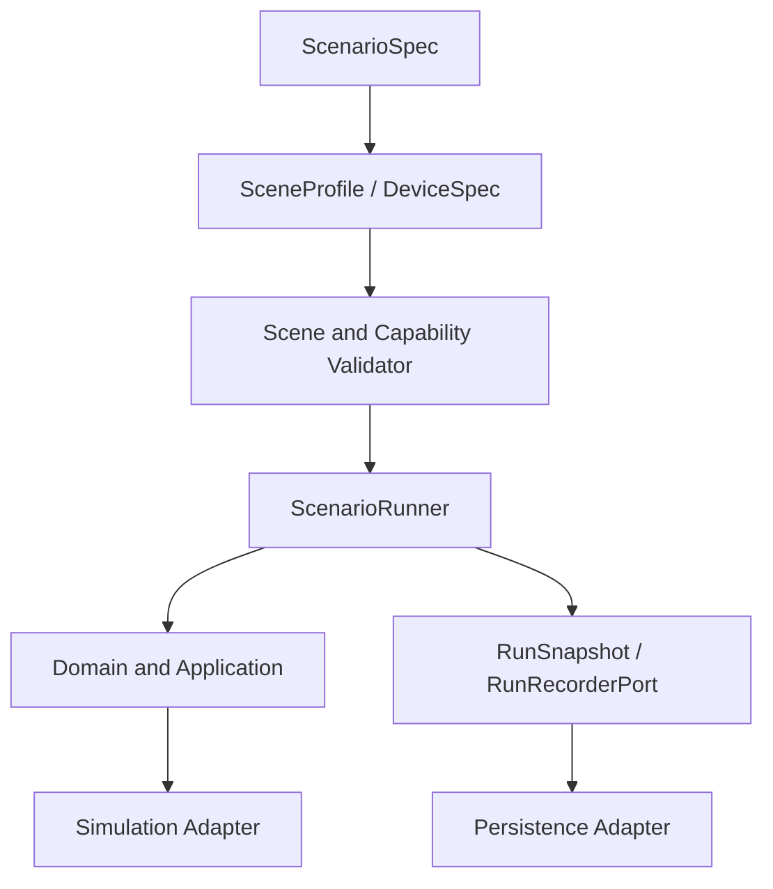

# 扩展场景与设备拓扑边界规划

## 目标

允许场景开发同学在不修改核心调度循环的情况下添加、删除和调整设备实例，
同时为新增设备类型、控制器和设备行为保留清晰的核心协作入口。

本规划解决的是代码边界和协作顺序，不要求拆成独立进程、微服务或多个发行包。

## 核心判断

场景开发可以包含设备增删，但必须区分以下两类变化：

| 变化 | 责任边界 |
|---|---|
| 添加已有类型的设备实例 | 场景模块通过 `SceneProfile` 声明 |
| 删除已有类型的设备实例 | 场景模块声明，同时通过拓扑和能力校验 |
| 修改设备数量、位置、区域、容量 | 场景配置或 profile 参数 |
| 新增设备类型 | 仿真 adapter 和设备能力由核心模块实现 |
| 新增控制器或执行器状态机 | simulation 负责人实现 |
| 改变资源锁、任务生命周期、物料转换或谱系语义 | domain/application 负责人评审并实现 |
| 新增数据库事实、报告字段或查询 | persistence/application 负责人实现 |

场景同学可以负责场景拓扑变化，但不应在场景分支中复制一套 coordinator、
资源状态机或 `sim.step()` 调度逻辑。

## 目标依赖结构



场景代码只依赖普通数据结构和场景注册入口。CoppeliaSim 句柄、资源锁、物料账本、
谱系提交和数据库事务由对应的核心模块拥有。

## 场景接口

### 场景定义

```python
@dataclass(frozen=True)
class ScenarioSpec:
    scenario_id: str
    scene_profile: str
    order_or_variant_id: str
    batch: dict[str, int]
    fault: str = "none"
    max_sim_time: float = 1200.0
    expected_acceptance: tuple[str, ...] = ()
```

### 设备声明

```python
@dataclass(frozen=True)
class DeviceSpec:
    device_id: str
    device_type: str
    scene_object: str
    region: str
    capabilities: tuple[str, ...]
    enabled: bool = True
```

### 场景拓扑

```python
@dataclass(frozen=True)
class SceneProfile:
    profile_id: str
    devices: tuple[DeviceSpec, ...]
```

### 仿真边界

场景运行入口接收 `ScenarioSpec`，完成配置装载、拓扑校验、能力校验和统一运行，
最终输出 `RunSnapshot`：

```python
class ScenarioRunner(Protocol):
    def run(self, spec: ScenarioSpec) -> RunSnapshot: ...
```

场景模块不直接调用以下对象：

- `Stage4Coordinator` 的内部状态；
- `MaterialRegistry` 的写入方法；
- 资源申请、释放和锁状态；
- `sim.step()`；
- CoppeliaSim 原始对象句柄；
- persistence 的具体 repository 或数据库连接。

## 设备增删的处理规则

### 添加已有设备类型

场景同学只需增加一个 `DeviceSpec`，并确保：

1. `device_id` 在场景内唯一；
2. `scene_object` 能映射到布局或场景工件中的对象；
3. `region` 已存在且允许该设备类型；
4. `capabilities` 是设备类型已注册的能力子集；
5. 相关工序、路线和资源配置可以发现该设备。

不应因为新增实例而修改 coordinator 主循环。

### 删除已有设备类型

删除设备前必须执行预检查：

1. 订单和工序是否仍有满足能力要求的设备；
2. 输入、输出端口和路线是否仍然连通；
3. 资源 owner、设备锁和任务引用是否出现悬空；
4. 场景工件和布局摘要是否仍与 profile 一致；
5. 预期物料流转、谱系边、事件顺序和验收条件是否仍成立。

校验失败时，场景应在启动前失败，并指出缺失的能力、端口、区域或资源引用，
而不是运行到中途才出现空引用或死锁。

### 新增设备类型

新增设备类型不是单纯的场景配置工作。场景同学先提交：

- `device_type` 和能力声明；
- 输入、输出和资源需求；
- 所属区域和布局要求；
- 生命周期、故障和验收行为；
- 需要的场景 fixture 和回归测试。

仿真负责人再实现：

- CoppeliaSim 对象绑定；
- adapter 和控制器；
- 轮询或事件接口；
- 故障状态和恢复行为。

如果新设备改变任务、资源、物料转换或谱系语义，还必须由 domain/application
负责人共同评审。

## 推荐目录

```text
scenarios/
  profiles/
    base.yaml
    with_extra_mixer.yaml
    without_buffer.yaml
  orders/
    standard.json
    high_volume.json
  fixtures/
  expected/
  tests/
```

场景目录只保存定义、输入、验收和测试。设备类型、控制器和物理绑定仍归属
`simulation` 或 `domain`，不在每个场景目录中复制。

## 模块边界和上下游依赖

| 模块 | 负责内容 | 上游 | 下游 | 禁止依赖 |
|---|---|---|---|---|
| `scenarios` | 场景定义、设备实例、订单变体、fixture、验收 | 用户需求、已注册能力 | `ScenarioRunner` | coordinator 私有字段、数据库、CoppeliaSim 句柄 |
| `application` | 场景装载、校验编排、运行用例、结果组装 | `ScenarioSpec`、领域服务 | `domain`、端口 | 具体场景分支、persistence 细节 |
| `domain` | 设备能力、任务、资源、物料和谱系规则 | 普通领域 DTO | application、simulation port | 场景目录、数据库 |
| `simulation` | 场景对象绑定、控制器、物理执行 | 已注册设备类型和 profile | CoppeliaSim | 场景业务判断、persistence |
| `persistence` | `RunSnapshot`、事件和谱系快照持久化 | application port | SQLite 或其他存储 | coordinator 私有状态 |

## 协作方式

### 工作包 A：核心负责人先建立边界

1. 增加 `ScenarioSpec`、`SceneProfile` 和 `DeviceSpec`。
2. 增加场景注册入口和 fake runner。
3. 增加设备唯一性、能力和引用完整性校验。
4. 增加至少一个添加设备和删除设备的契约测试。
5. 固定 `RunSnapshot` 输出格式。

### 工作包 B：场景负责人独立扩展

1. 在 `scenarios/profiles` 增加 profile。
2. 在订单目录增加变体或批次配置。
3. 增加 fixture、预期结果和 focused tests。
4. 只通过 profile 声明设备拓扑变化。
5. 用验收结果证明设备增删没有破坏物料、资源和事件语义。

### 工作包 C：能力缺口协作

如果 profile 无法表达需求，场景负责人先提交端口或能力变更说明，包含：

- 当前缺失的设备能力；
- 期望的输入输出和生命周期；
- 对资源、任务、物料和谱系的影响；
- 最小回归场景和验收条件。

核心负责人完成 adapter、domain 或 persistence 变更后，场景负责人再补充实际场景。

## PR 边界

建议拆成以下独立 PR：

1. `scenario-contract`: 场景和设备声明对象、注册入口、fake runner。
2. `scene-validation`: 拓扑、能力、端口和引用校验。
3. `scenario-profile-*`: 具体场景的设备增删和订单变体。
4. `device-capability-*`: 新设备类型或新设备行为。
5. `scenario-acceptance-*`: 运行快照、验收测试和文档。

场景 PR 不应同时修改 coordinator 主循环、资源锁实现和数据库映射，除非该 PR
明确是经评审的能力扩展。

## 验收标准

设备增删场景合并前至少满足：

- 场景能通过统一 runner 启动；
- profile 中设备 ID 和场景对象映射唯一；
- 所有订单工序都有可用能力；
- 路由、端口、区域和资源引用无悬空；
- 仿真仍由唯一的 `Stage4Coordinator.step()` 和 `sim.step()` 驱动；
- `RunSnapshot` 能记录运行结果、设备摘要、物料和谱系结果；
- 旧场景回归测试通过；
- 新场景验收条件通过。

## 结论

扩展场景可以负责已有设备实例的添加、删除和参数调整。新增设备类型、控制器、
执行器状态机或领域语义时，必须通过核心模块的能力扩展流程完成。

解耦的关键不是禁止场景改设备，而是把设备拓扑声明、能力校验、物理绑定和领域
行为分开，使场景负责人可以独立组合拓扑，核心负责人继续拥有运行时状态和执行顺序。
